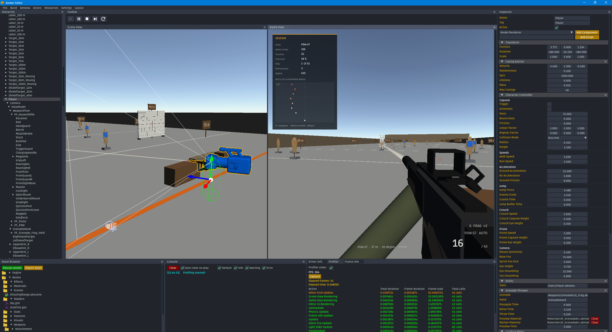

<p align="center">
  
</p>

<p align="center">
  
  
  
  
  
</p>

<p align="center">
  <a href="#whats-different-from-overload">What's different from Overload</a> |
  <a href="#features">Features</a> |
  <a href="#architecture">Architecture</a> |
  <a href="#dependencies">Dependencies</a> |
  <a href="#building-from-sources">Building From Sources</a>
</p>

AmberEngine is a personal 3D game engine written in C++ with Lua as its scripting language.

<p align="center">
  
</p>

## What's different from Overload
It is based on [Overload](https://github.com/Overload-Technologies/Overload) and follows its architecture, while diverging where it aims for a simpler or improved design:
- Plugin-free UI module: widgets expose events directly instead of Overload's plugin system, and widget containers are draw-safe (widgets can be created, removed or transferred while the UI is drawing)
- Multiple actor selection
- Lasso selection with group gizmo transforms
- Hierarchy quality of life improvements: drag and drop in-between reordering with insertion preview, actor creation menu directly from the Hierarchy panel
- Ambient box light OBB shading
- Layout management
- GLM as the mathematics library
- Various editor quality of life features

## Features
- Lua scripting
- Scene editor with play mode
- Windows game building
- Physically-Based Rendering (PBR)
- Custom shaders support
- Material editor
- Asset browser
- Rigidbody physics
- 3D audio
- Profiling tools

## Architecture
AmberEngine is divided into 11 modules: 9 libraries and 2 applications.

### Libraries
| Module | Role |
|---|---|
| `AmberDebug` | Logging and assertions |
| `AmberTools` | File system, events, clock, and more |
| `AmberMaths` | Mathematics, built around [GLM](https://github.com/g-truc/glm) |
| `AmberAudio` | Audio engine, built around [irrKlang](https://www.ambiera.com/irrklang/) |
| `AmberPhysics` | Physics engine, built around [Bullet3](https://github.com/bulletphysics/bullet3) |
| `AmberRendering` | OpenGL rendering engine |
| `AmberWindowing` | Windowing and inputs, built around [GLFW](https://github.com/glfw/glfw) |
| `AmberUI` | Widget-based UI, built around [ImGui](https://github.com/ocornut/imgui) |
| `AmberCore` | Component-based scene system, scripting, and resource management |

### Applications
| Module | Role |
|---|---|
| `AmberEditor` | The editor for building your game |
| `AmberGame` | A data-driven executable for any game built with AmberEngine |

## Dependencies
| Library | Use |
|---|---|
| [GLEW](https://github.com/nigels-com/glew) | OpenGL functions loader |
| [GLFW](https://github.com/glfw/glfw) | Windowing and inputs |
| [GLM](https://github.com/g-truc/glm) | Mathematics |
| [Assimp](https://github.com/assimp/assimp) | 3D models loader |
| [Bullet3](https://github.com/bulletphysics/bullet3) | Physics |
| [irrKlang](https://www.ambiera.com/irrklang/) | Audio |
| [Lua](https://www.lua.org/) + [sol2](https://github.com/ThePhD/sol2) | Scripting |
| [ImGui](https://github.com/ocornut/imgui) | GUI |
| [tinyxml2](https://github.com/leethomason/tinyxml2) | Serialization |
| [stb_image](https://github.com/nothings/stb) | Images loader |
| [Premake5](https://github.com/premake/premake-core) | Project generation |

## Requirements
- Windows 10 or newer
- Visual Studio 2022 or newer
- GPU supporting OpenGL 4.3

## Building From Sources
```powershell
git clone https://github.com/maxbrundev/AmberEngine
cd AmberEngine
.\GenerateProject.bat # Generate project files for Visual Studio 2022
.\Sources\Amber\Amber.sln # Open the solution in Visual Studio
```

AmberEngine uses Premake5 to generate project files. To generate them, execute `GenerateProject.bat` located at the root of the repository. By default, `GenerateProject.bat` generates project files for Visual Studio 2022, selecting the latest installed MSVC toolset and Windows SDK automatically so the solution opens without any retargeting prompt. If you want to use another version of Visual Studio (vs2019, vs2017...) or another IDE (see https://github.com/premake/premake-core/), you can execute `GenerateProject.bat` from the command line with an argument (e.g. `.\GenerateProject.bat vs2019`).

## Licence
AmberEngine is licenced under an MIT Licence.
